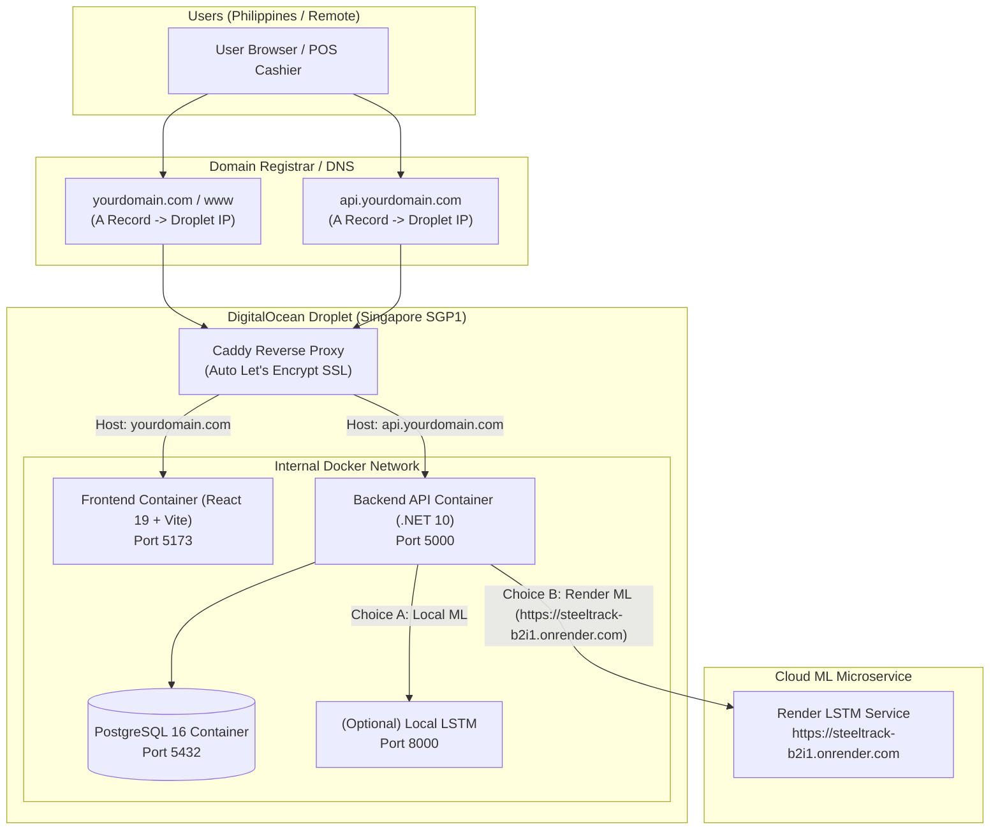

# DigitalOcean Droplet Deployment Walkthrough
**Complete Step-by-Step Guide for SteelTrack Deployment on DigitalOcean**

---

## 1. Overview & Architecture

### What Should You Deploy on DigitalOcean: Backend, Frontend, or Both?

👉 **Recommendation: Deploy BOTH on DigitalOcean (All-in-One Droplet).**

Here is why and how the two approaches compare:

| Strategy | Frontend (React) | Backend (C# API) & Database | ML Model | Why Choose This? |
| :--- | :--- | :--- | :--- | :--- |
| **Strategy 1: All-in-One Droplet (Recommended)** | **DigitalOcean Droplet** | **DigitalOcean Droplet** | **Render** (`steeltrack-b2i1.onrender.com`) | **Easiest & Cleanest.** Since you are already paying for the Droplet, running both on it costs $0 extra. The React frontend is very lightweight (~50MB RAM). One server, one `docker compose up -d` command, and zero cross-cloud CORS issues. |
| **Strategy 2: Split Deployment** | **Vercel / Cloudflare Pages** (Free CDN) | **DigitalOcean Droplet** | **Render** (`steeltrack-b2i1.onrender.com`) | **Good for global caching.** You host the React files on Vercel for free, while your C# API and PostgreSQL run on DigitalOcean. Requires managing two separate hosting dashboards. |

> [!IMPORTANT]
> **Can you deploy ONLY the frontend on DigitalOcean?**
> **No / Not recommended.** A DigitalOcean Droplet is a full Linux server with CPU and RAM meant for running backend code, databases, and Docker containers. Paying $12/month just for static React files is unnecessary because static hosting is free on Vercel, Netlify, or Cloudflare Pages. 
> 
> If you are using DigitalOcean, the **Backend API and Database are the primary components that belong on the Droplet**. Adding the frontend container alongside them takes almost no extra resources!

---



---

## 2. DigitalOcean Account Setup & GCash Payment

DigitalOcean accepts payment methods accessible from the Philippines:

1. **Sign Up:** Go to [digitalocean.com](https://www.digitalocean.com). *(Tip: If you have the GitHub Student Developer Pack, you get $200 in free credits).*
2. **Payment Method:**
   * **Method 1 (PayPal linked to GCash):** At billing, select **PayPal**. Authorize recurring billing using your linked GCash wallet or GCash card.
   * **Method 2 (GCash Virtual Card):** In your GCash app, go to *Profile > My Linked Accounts > GCash Card / Virtual Pay*. Enter the 16-digit Visa/Mastercard number directly into DigitalOcean.

---

## 3. Creating & Sizing Your Droplet

1. In your DigitalOcean Control Panel, click the green **Create** button (top right) $\to$ **Droplets**.
2. **Choose Region:** Select **Singapore (`SGP1`)**.  
   *(Singapore provides the lowest latency to the Philippines—typically 25ms to 35ms on PLDT, Globe, and Converge).*
3. **Choose Image:**
   * Select **OS** tab $\to$ **Ubuntu 24.04 (LTS) x64**.
4. **Choose Droplet Size (CPU & RAM):**
   * **Option A (If using your Render LSTM model `steeltrack-b2i1.onrender.com`):**
     * Select **Basic Plan** $\to$ **Regular SSD** $\to$ **$12/month (2 GB RAM, 1 vCPU, 50 GB SSD)**. 
     * *(Because ML inference is offloaded to Render, 2 GB is more than enough for PostgreSQL, C# API, and React).*
   * **Option B (If hosting everything including ML on the Droplet):**
     * Select **Basic Plan** $\to$ **Regular SSD** $\to$ **$12/month (2 GB RAM + 4 GB Swap)** or **$24/month (4 GB RAM, 2 vCPU)**.
5. **Authentication:**
   * Select **SSH Key** (recommended) or choose **Password** and set a strong root password.
6. **Finalize & Create:**
   * Hostname: `steeltrack-server`
   * Click **Create Droplet**.
7. Wait 60 seconds. DigitalOcean will display your Droplet's **public IPv4 address** (e.g., `159.223.45.120`).

---

## 4. Connecting Your Custom Domain (DNS Setup)

Go to wherever you purchased your domain (Namecheap, GoDaddy, Hostinger, Cloudflare, etc.) and open **DNS Management**.

Add these 3 **A Records** pointing to your Droplet IP (replace `159.223.45.120` with your real Droplet IP):

| Record Type | Host / Name | Target / Value (Droplet IP) | TTL | Purpose |
| :--- | :--- | :--- | :--- | :--- |
| **A** | `@` | `159.223.45.120` | `300` (5 min) / Automatic | Routes `yourdomain.com` to Frontend |
| **A** | `www` | `159.223.45.120` | `300` (5 min) / Automatic | Routes `www.yourdomain.com` to Frontend |
| **A** | `api` | `159.223.45.120` | `300` (5 min) / Automatic | Routes `api.yourdomain.com` to C# Backend |

> [!TIP]
> **What to do with existing default records (like `CNAME www` or "Parking Page")?**
> * **Yes, DELETE the existing `CNAME` for `www`!** Most registrars (like Namecheap or GoDaddy) create a default placeholder CNAME pointing to a parking page.
> * **Why you must delete it:** DNS rules strictly forbid having both an `A` record and a `CNAME` record on the exact same name (`www`). Deleting the old CNAME allows you to add the `A` record for `www` without error.
> * *Alternative:* If you prefer to keep the `CNAME` for `www`, simply change its Target/Value from the parking page to `@` (or `yourdomain.com`). In that case, you do not need the `A` record for `www`.

> [!NOTE]
> **Is TTL in seconds or minutes?**
> DNS TTL (Time to Live) is standardly measured in **seconds**:
> * **`300` = 300 seconds (5 minutes)**.
> * If your registrar displays a number input, type **`300`**.
> * If your registrar displays a dropdown menu, select **`Automatic`** or **`5 min`**.
> * DNS propagation typically takes 5 to 15 minutes. Verify it in PowerShell:
>   ```powershell
>   Resolve-DnsName api.yourdomain.com
>   ```

---

## 5. Initial Server Setup (SSH & Docker Installation)

> [!IMPORTANT]
> **WHERE TO RUN THESE COMMANDS? (From Step 5.1 to Step 9):**
> * All commands in Steps 5 through 9 must be run **INSIDE your remote DigitalOcean Droplet terminal** (NOT on your local Windows PC, and NOT in VS Code).
> * You can connect in two ways:
>   * **Option A (In your browser):** In your DigitalOcean Control Panel, click your Droplet, then click the **Console** button in the top right.
>   * **Option B (Windows PowerShell):** Open PowerShell on your computer and SSH into your Droplet:
>     ```powershell
>     ssh root@159.223.45.120
>     ```
> * **How to know you are connected:** Your command prompt will change to:
>   ```text
>   root@steeltrack-server:~#
>   ```
>   Once you see `root@...:~#`, every command below is run inside that terminal!

---

### Step 5.1: Create a 4 GB Swap File (Crucial Memory Safety)
Inside your Droplet terminal, run these 4 commands to configure swap memory on the SSD:
```bash
fallocate -l 4G /swapfile && chmod 600 /swapfile
mkswap /swapfile && swapon /swapfile
echo '/swapfile none swap sw 0 0' | tee -a /etc/fstab
sysctl vm.swappiness=10
```

### Step 5.2: Install Docker & Docker Compose
```bash
# Update Ubuntu package lists
apt update && apt upgrade -y

# Install prerequisites
apt install -y curl git ca-certificates gnupg ufw

# Add Docker's official GPG key & repository
install -m 0755 -d /etc/apt/keyrings
curl -fsSL https://download.docker.com/linux/ubuntu/gpg | gpg --dearmor -o /etc/apt/keyrings/docker.gpg
chmod a+r /etc/apt/keyrings/docker.gpg

echo \
  "deb [arch=$(dpkg --print-architecture) signed-by=/etc/apt/keyrings/docker.gpg] https://download.docker.com/linux/ubuntu \
  $(. /etc/os-release && echo "$VERSION_CODENAME") stable" | \
  tee /etc/apt/sources.list.d/docker.list > /dev/null

apt update
apt install -y docker-ce docker-ce-cli containerd.io docker-buildx-plugin docker-compose-plugin

# Enable Docker on boot
systemctl enable --now docker
```

---

## 6. Clone the SteelTrack Project & Configure Environment

```bash
mkdir -p /var/www
cd /var/www
git clone https://github.com/<your-username>/SteelTrack.git
cd SteelTrack
```

### Step 6.1: Create Your Production `.env` File
```bash
nano .env
```

Paste the following production configuration:
```ini
# PostgreSQL Database
POSTGRES_DB=SteelTrackDb
POSTGRES_USER=steeltrack_admin
POSTGRES_PASSWORD=YourSuperStrongPostgresPassword2026!
POSTGRES_PORT=5432

# ASP.NET Core Backend
ASPNETCORE_ENVIRONMENT=Production
JWT_SECRET=SteelTrack_Super_Secure_Production_JWT_Secret_Key_2026_XYZ987654321!

# React Frontend (Points to your custom API subdomain)
VITE_API_URL=https://api.yourdomain.com

# LSTM Neural Forecasting Configuration
# Option 1: Using your Render model:
LSTM_BASE_URL=https://steeltrack-b2i1.onrender.com
LSTM_API_KEY=st_live_lstm_dAnBjPTeD6YZCoQdm5UX5RpZVDBqRSRLrctKzG8z-bQ

# Option 2: Using the local Docker LSTM model (if running inside Droplet):
# LSTM_BASE_URL=http://steeltrack-lstm:8000
```
Save and exit: press `Ctrl + O`, `Enter`, then `Ctrl + X`.

---

## 7. How to Use Your Deployed Render LSTM Model

Since you already deployed your model to Render at **`https://steeltrack-b2i1.onrender.com`**, you can connect your backend to it in 1 simple step:

### In `backend/API/appsettings.Production.json`:
Verify or update the `Lstm` section to point to your Render URL:
```json
  "Lstm": {
    "BaseUrl": "https://steeltrack-b2i1.onrender.com",
    "ApiKey": "st_live_lstm_dAnBjPTeD6YZCoQdm5UX5RpZVDBqRSRLrctKzG8z-bQ",
    "LookbackMonths": 24,
    "HorizonMonths": 3,
    "ModelVersion": "v1.0.0-keras-lstm"
  }
```

> [!NOTE]
> **What about the Render outbound IP addresses (`74.220.52.0/24`, `74.220.60.0/24`)?**
> In this architecture:
> * Your **Droplet talks TO Render** (outbound HTTPS calls from Droplet to `https://steeltrack-b2i1.onrender.com`).
> * Render does **not** need to call into your Droplet.
> * Therefore, you do **not** need to whitelist Render's outbound IPs in your Droplet firewall! The connection works automatically over public HTTPS.

---

## 8. Automatic SSL Setup with Caddy Reverse Proxy

Create a `Caddyfile` in `/var/www/SteelTrack`:
```bash
nano Caddyfile
```

Paste the following configuration (replace `yourdomain.com` with your real registered domain):
```caddy
# Frontend Web App (React 19 Vite)
yourdomain.com, www.yourdomain.com {
    reverse_proxy vite-preview:5173
}

# Backend API (.NET 10 API & SignalR WebSockets)
api.yourdomain.com {
    reverse_proxy steeltrack-api:5000 {
        header_up Host {host}
        header_up X-Real-IP {remote}
        header_up X-Forwarded-For {remote}
        header_up X-Forwarded-Proto {scheme}
    }
}
```
Save and exit (`Ctrl + O`, `Enter`, `Ctrl + X`).

---

## 9. Launch the Application on DigitalOcean

### Step 9.1: Configure Server Firewall
```bash
ufw allow 22/tcp    # SSH
ufw allow 80/tcp    # HTTP (Let's Encrypt validation)
ufw allow 443/tcp   # HTTPS
ufw enable -y
```

### Step 9.2: Build & Start All Containers
In `/var/www/SteelTrack`, run:
```bash
docker compose up -d --build
```

### Step 9.3: Verify Running Services
```bash
docker compose ps
```
You will see all containers in the `running` state:
* `steeltrack-postgres`
* `steeltrack-api`
* `steeltrack-frontend`
* `steeltrack-proxy` (Caddy automatically issued your HTTPS certificates)

---

## 10. Post-Deployment Verification

1. **Test Frontend:** Open `https://yourdomain.com` in your browser. The page should load securely with a valid SSL padlock.
2. **Test Backend API:** Open `https://api.yourdomain.com/swagger` or `https://api.yourdomain.com/api/forecast/diagnostics`.
3. **Test Render LSTM Model from Droplet:**
   Inside your Droplet SSH terminal, verify that the Droplet can reach your Render service:
   ```bash
   curl -s https://steeltrack-b2i1.onrender.com/health
   ```
   You should receive:
   ```json
   {"status":"healthy","model_loaded":true,"catalog_products":646}
   ```
4. **Test in UI:** Navigate to the **Owner Forecast** view in SteelTrack. Select a product and confirm that predictions are retrieved and displayed from your Render LSTM model.
