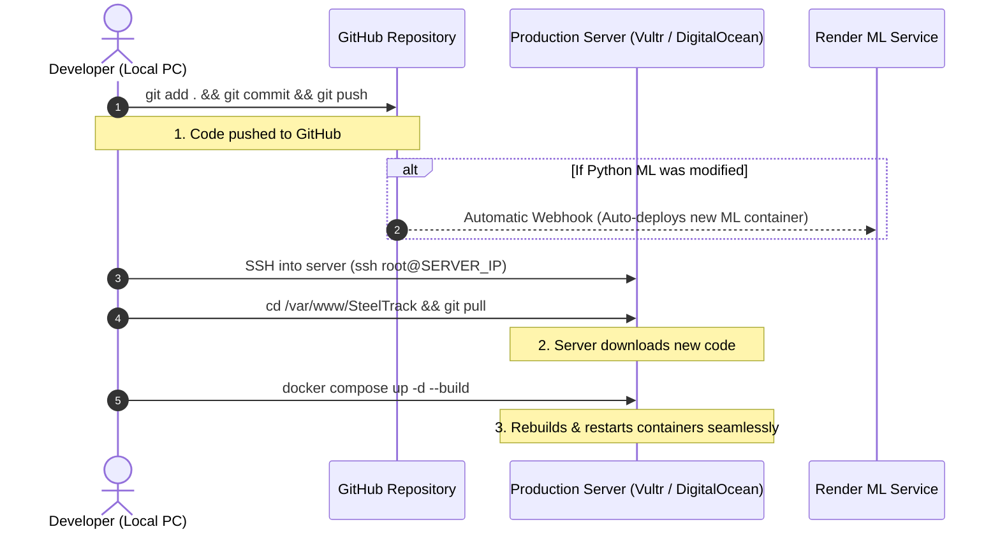

# SteelTrack Update & Redeployment Walkthrough
**How to Deploy Code Updates, New Features, and Bug Fixes to Production**

---

## 1. Overview of the Update Workflow

Whenever you make changes to your code (editing frontend components, updating backend APIs, changing business logic, or modifying database models), updating your live production server takes **3 simple steps**:



---

## 2. Step 1: Push Your Changes from Your Local PC

On your Windows computer (in your VS Code or local terminal):

1. Check what files you changed:
   ```bash
   git status
   ```
2. Stage and commit your changes:
   ```bash
   git add .
   git commit -m "Update feature XYZ and fix styling"
   ```
3. Push to your GitHub repository:
   ```bash
   git push origin main
   ```
   *(Replace `main` with your active branch name, e.g. `patch1.0`).*

---

## 3. Step 2: Apply the Update on Your Server (Vultr / DigitalOcean)

Open **PowerShell** on your PC and connect to your server:

```powershell
ssh root@<YOUR_SERVER_IP>
```

### The 3 Standard Update Commands:
Once logged into your server, paste these commands:

```bash
# 1. Navigate to your project directory
cd /var/www/SteelTrack

# 2. Pull the latest code from GitHub
git pull

# 3. Rebuild and restart the containers in the background
docker compose up -d --build
```

**That's it!** Docker Compose will:
* Detect only the files that changed.
* Build the updated container in the background.
* Gracefully swap the old container with the new version with **zero downtime** (your database data and volumes stay 100% safe and intact).

---

## 4. Fast Rebuilds (Targeting a Single Component)

If you only changed the **frontend** or only changed the **backend**, you don't need to rebuild the entire stack! You can target only the service you touched to deploy in seconds:

### Scenario A: You Only Changed the Frontend (React / CSS / UI)
```bash
cd /var/www/SteelTrack
git pull
docker compose up -d --build vite-preview
```
*(Takes ~15–30 seconds!)*

### Scenario B: You Only Changed the Backend API (.NET C#)
```bash
cd /var/www/SteelTrack
git pull
docker compose up -d --build steeltrack-api
```

---

## 5. What If You Updated the Python LSTM Model?

If you modified the Python code in `ml/`:
* **Render Auto-Deploys:** Because your LSTM service is connected to your GitHub repository on Render, Render will automatically detect your `git push` and trigger a fresh build.
* **Manual Verification:** Open your Render dashboard $\to$ click your `steeltrack-b2i1` service $\to$ verify that the latest deployment says **`Live`**.

---

## 6. What If You Changed Database Entities (EF Core Migrations)?

If you added new tables, columns, or modified Entity Framework models in `backend/Domain/` or `backend/Infrastructure/`:

1. Run the database migration command inside your server:
   ```bash
   docker exec -it steeltrack-api dotnet ef database update
   ```
   *(Or if your `Program.cs` includes `app.Services.MigrateDatabase()`, restarting the container in Step 3 automatically applies new migrations).*

---

## 7. Server Housekeeping: Clean Up Old Docker Images

Over time, running `docker compose up -d --build` repeatedly creates unused old image layers that consume SSD disk space.

Run this command once every few updates to reclaim disk space:
```bash
docker image prune -f
```
*(This safely removes orphaned build layers without touching your active containers, database volumes, or code).*

---

## 8. Pro-Tip: The One-Command "Deploy Script"

You can create an automated update script on your server so you only ever have to type **`./deploy.sh`** to update the system.

### Create the script once on your server:
```bash
cat << 'EOF' > /var/www/SteelTrack/deploy.sh
#!/bin/bash
set -e

echo "=== Pulling latest changes from GitHub ==="
git pull

echo "=== Rebuilding and updating Docker containers ==="
docker compose up -d --build

echo "=== Cleaning up dangling images ==="
docker image prune -f

echo "=== Checking container health ==="
docker compose ps

echo "🚀 SteelTrack update successfully deployed!"
EOF

chmod +x /var/www/SteelTrack/deploy.sh
```

### From now on, whenever you push an update, just run:
```bash
cd /var/www/SteelTrack && ./deploy.sh
```
It handles pulling code, rebuilding, pruning old images, and verifying health in one go!
