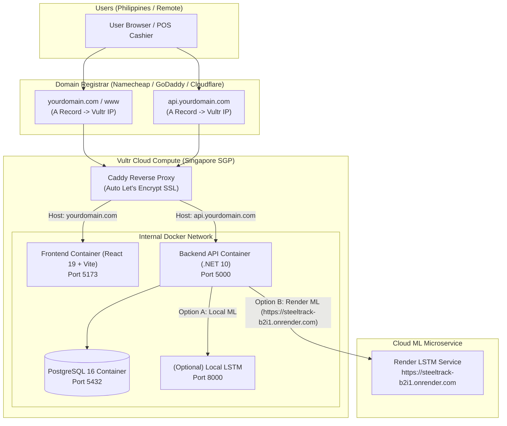

# Vultr Cloud Deployment Walkthrough
**Complete Step-by-Step Guide for SteelTrack Deployment on Vultr**

---

## 1. Overview & Architecture

This guide walks you through deploying the complete **SteelTrack** enterprise application on a **Vultr Cloud Compute** instance (running **Ubuntu 24.04 LTS** in the **Singapore** datacenter) with your custom domain and automatic free SSL/TLS certificates.



### What to Deploy on Vultr:
👉 **Deploy BOTH the Frontend, Backend, and PostgreSQL database on the Vultr instance.**  
Your heavy Python ML model is already hosted on Render (`https://steeltrack-b2i1.onrender.com`), meaning a $10/month Vultr instance has more than enough power to host everything else with zero latency.

---

## 2. Vultr Account Setup & GCash Payment

Vultr is one of the most developer-friendly cloud providers for the Philippines and accepts multiple Philippine payment options:

1. **Sign Up:** Go to [vultr.com](https://www.vultr.com).
2. **Payment Methods Supported:**
   * **Method 1: GCash Virtual Card (Visa / Mastercard):**
     * Open the **GCash App** $\to$ *Profile > My Linked Accounts > GCash Card / Virtual Pay*.
     * Copy your 16-digit card number, expiry, and CVV.
     * Enter it on Vultr under the **Credit Card** tab.
   * **Method 2: PayPal Linked to GCash:**
     * Link your GCash account or GCash card inside PayPal.
     * On Vultr's billing screen, select **PayPal** and authorize the charge.
   * **Method 3: Alipay+:**
     * Vultr natively accepts Alipay, which integrates directly with GCash via the Alipay+ cross-border payment network.

---

## 3. Deploying Your Vultr Cloud Compute Instance

1. Log into your **Vultr Customer Portal**.
2. Click the blue **Deploy +** button (top right) $\to$ **Deploy New Server**.
3. **Choose Type:**
   * Select **Cloud Compute - Shared CPU**.
4. **Choose Server Location:**
   * Select **Singapore (`sgp`)**.  
     *(Singapore has direct high-speed subsea fiber cables to Manila and Cebu, giving PLDT, Globe, and Converge users a blistering 20ms–35ms ping).*
5. **Choose Operating System Image:**
   * Select the **Operating System** tab $\to$ **Ubuntu** $\to$ **24.04 LTS x64**.
   * *(Optional: Under the Marketplace tab, you can select "Docker" to have Docker pre-installed).*
6. **Choose Server Plan (CPU & RAM):**
   * Select **Regular Performance** or **High Performance**:
     * **$10.00 / month (2 GB RAM, 1 vCPU, 55 GB SSD, 2 TB Bandwidth)**.
     * *(With ML running on Render, 2 GB RAM + 4 GB Swap is optimal for SteelTrack).*
7. **Server Settings:**
   * Enable **Auto Backups** (optional, $2/mo).
   * SSH Keys: Add your local computer's public SSH key, or select **Password** to receive a generated root password.
   * Server Hostname & Label: `steeltrack-vultr`
8. Click **Deploy Now**.
9. In ~60 seconds, Vultr will mark your instance as **Running** and display its **Public IPv4 Address** (e.g., `139.180.142.85`).

---

## 4. Connecting Your Custom Domain (DNS Setup)

Open your domain registrar's DNS settings (e.g., Namecheap, GoDaddy, Hostinger, or Cloudflare) and add these 3 **A Records** pointing to your Vultr server IP:

| Record Type | Host / Name | Value / Destination (Vultr IP) | TTL | Purpose |
| :--- | :--- | :--- | :--- | :--- |
| **A** | `@` | `139.180.142.85` *(your Vultr IP)* | `300` (5 min) / Automatic | Routes `yourdomain.com` to Frontend |
| **A** | `www` | `139.180.142.85` *(your Vultr IP)* | `300` (5 min) / Automatic | Routes `www.yourdomain.com` to Frontend |
| **A** | `api` | `139.180.142.85` *(your Vultr IP)* | `300` (5 min) / Automatic | Routes `api.yourdomain.com` to C# Backend |

> [!TIP]
> **What to do with existing default records (like `CNAME www` or "Parking Page")?**
> * **Yes, DELETE the existing `CNAME` for `www`!** Most registrars (like Namecheap or GoDaddy) create a default placeholder CNAME pointing to a parking page.
> * **Why you must delete it:** DNS rules strictly forbid having both an `A` record and a `CNAME` record on the exact same name (`www`). Deleting the old CNAME allows you to add the `A` record for `www` without error.
> * *Alternative:* If you prefer to keep the `CNAME` for `www`, simply change its Target/Value from the parking page to `@` (or `yourdomain.com`). In that case, you do not need the `A` record for `www`.

> [!NOTE]
> **Is TTL in seconds or minutes?**
> DNS TTL (Time to Live) is standardly measured in **seconds**:
> * **`300` = 300 seconds (5 minutes)**.
> * If your registrar (e.g. Namecheap, Cloudflare, GoDaddy) has a numeric box, enter **`300`**.
> * If your registrar has a dropdown menu, select **`Automatic`** or **`5 min`** (or `1 min`).
> * DNS propagation typically takes 5 to 15 minutes. Verify it in PowerShell:
>   ```powershell
>   Resolve-DnsName api.yourdomain.com
>   ```

---

## 5. Server Setup & Memory Configuration

> [!IMPORTANT]
> **WHERE TO RUN THESE COMMANDS? (From Step 5.1 to Step 9):**
> * All commands in Steps 5 through 9 must be run **INSIDE your remote Vultr Ubuntu server terminal** (NOT on your local Windows PC, and NOT in VS Code).
> * You can open your server's terminal in two ways:
>   * **Option A (Easiest — Built-in Vultr Web Console):**
>     1. In your [Vultr Dashboard](https://my.vultr.com), click on your server.
>     2. In the top right corner, click the **`>_ View Console`** button. A black screen opens in your browser.
>     3. **When it asks `login:`** $\to$ Type: **`root`** and press **Enter**.
>     4. **When it asks `Password:`** $\to$ Copy the password from your Vultr server overview page and paste/type it, then press **Enter**.
>        *(Note: In Linux, the cursor will NOT move and no dots or asterisks will show when typing your password—this is normal security behavior! Just type it carefully and press Enter).*
>   * **Option B (Using Windows PowerShell):** Open PowerShell on your computer and SSH into your server:
>     ```powershell
>     ssh root@139.180.142.85
>     ```
>     *(Replace with your actual Vultr IP. Type `yes` when prompted, then enter your root password).*
> * **How to know you are logged in:** Your terminal prompt will display:
>   ```text
>   root@steeltrack-vultr:~#
>   ```
>   Once you see `root@...:~#`, you are successfully logged in. Now run the commands below!

---

### Step 5.1: Create a 4 GB NVMe Swap File
Inside your Vultr server terminal, run these commands to prevent memory exhaustion during Docker builds:
```bash
fallocate -l 4G /swapfile && chmod 600 /swapfile
mkswap /swapfile && swapon /swapfile
echo '/swapfile none swap sw 0 0' | tee -a /etc/fstab
sysctl vm.swappiness=10
```

> [!NOTE]
> **If you see `Text file busy` or `/swapfile is mounted`:**
> This is completely normal and great news! It means Vultr **already pre-created and activated a swap file** for your server. You can check it with `free -h` or `swapon --show`. You are done with Step 5.1 and can proceed directly to Step 5.2!

### Step 5.2: Install Docker & Docker Compose
Inside your Vultr server terminal, install Docker:
```bash
# Update Ubuntu package manager
apt update && apt upgrade -y

# Install prerequisites
apt install -y curl git ca-certificates gnupg ufw

# Install official Docker repository
install -m 0755 -d /etc/apt/keyrings
curl -fsSL https://download.docker.com/linux/ubuntu/gpg | gpg --dearmor -o /etc/apt/keyrings/docker.gpg
chmod a+r /etc/apt/keyrings/docker.gpg

echo \
  "deb [arch=$(dpkg --print-architecture) signed-by=/etc/apt/keyrings/docker.gpg] https://download.docker.com/linux/ubuntu \
  $(. /etc/os-release && echo "$VERSION_CODENAME") stable" | \
  tee /etc/apt/sources.list.d/docker.list > /dev/null

apt update
apt install -y docker-ce docker-ce-cli containerd.io docker-buildx-plugin docker-compose-plugin

# Enable and start Docker service
systemctl enable --now docker
```

> [!TIP]
> **If a purple/blue dialog screen appears during package installation:**
> * **If it asks `Override local changes to /etc/pam.d/common-*?`:** Select **`<Yes>`** (use the **Tab** or **Arrow keys** to highlight `<Yes>`, then press **Enter**).
> * **If it asks "Which services should be restarted?":** Just press **Enter** to accept the default `<Ok>`.

---

## 6. Clone SteelTrack & Configure Environment

```bash
mkdir -p /var/www
cd /var/www
git clone https://github.com/<your-username>/SteelTrack.git
cd SteelTrack
```

### Step 6.1: Create Your Production `.env` File
```bash
nano .env
```

Paste your production environment variables:
```ini
# PostgreSQL Database
POSTGRES_DB=SteelTrackDb
POSTGRES_USER=steeltrack_admin
POSTGRES_PASSWORD=YourStrongDatabasePassword2026!
POSTGRES_PORT=5432

# ASP.NET Core Backend
ASPNETCORE_ENVIRONMENT=Production
JWT_SECRET=SteelTrack_Super_Secure_Production_JWT_Secret_Key_2026_XYZ987654321!

# React Frontend (Points to your custom API subdomain)
VITE_API_URL=https://api.yourdomain.com

# LSTM Neural Forecasting (Points to your Render instance)
LSTM_BASE_URL=https://steeltrack-b2i1.onrender.com
LSTM_API_KEY=st_live_lstm_dAnBjPTeD6YZCoQdm5UX5RpZVDBqRSRLrctKzG8z-bQ
```
Save and exit: press `Ctrl + O`, `Enter`, then `Ctrl + X`.

---

## 7. Connecting to Your Render LSTM Model

Your codebase is already pre-configured to communicate with Render.

In [backend/API/appsettings.Production.json](file:///d:/It_Project/Capstone/SteelTrack/backend/API/appsettings.Production.json#L23-L29), verify that `BaseUrl` points to your live Render service:
```json
  "Lstm": {
    "BaseUrl": "https://steeltrack-b2i1.onrender.com",
    "ApiKey": "st_live_lstm_dAnBjPTeD6YZCoQdm5UX5RpZVDBqRSRLrctKzG8z-bQ",
    "LookbackMonths": 24,
    "HorizonMonths": 3,
    "ModelVersion": "v1.0.0-keras-lstm"
  }
```

> [!TIP]
> **No Firewall Configuration Needed for Render:**
> Your Vultr instance initiates standard outbound HTTPS queries to `https://steeltrack-b2i1.onrender.com`. Render never opens connections into your Vultr server, so Render's outbound IPs (`74.220.52.0/24`, `74.220.60.0/24`) do not need to be whitelisted.

---

## 8. Automatic SSL Setup with Caddy Reverse Proxy

Create a `Caddyfile` in the project root on Vultr:
```bash
nano Caddyfile
```

Paste this configuration (replace `yourdomain.com` with your real purchased domain):
```caddy
# Frontend Application (React 19 Vite)
yourdomain.com, www.yourdomain.com {
    reverse_proxy vite-preview:5173
}

# Backend API (.NET 10 API & SignalR WebSockets)
api.yourdomain.com {
    reverse_proxy steeltrack-api:5000 {
        header_up Host {host}
        header_up X-Real-IP {remote}
        header_up X-Forwarded-For {remote}
        header_up X-Forwarded-Proto {scheme}
    }
}
```
Save and exit (`Ctrl + O`, `Enter`, `Ctrl + X`).

---

## 9. Launch the Stack on Vultr

### Step 9.1: Configure Server Firewall
Run these commands **right inside your server terminal** (this configures Ubuntu's built-in `ufw` firewall):
```bash
ufw allow 22/tcp    # Keeps your SSH terminal connection open
ufw allow 80/tcp    # Allows HTTP (for Let's Encrypt SSL certificate issuance)
ufw allow 443/tcp   # Allows HTTPS (for secure web traffic)
ufw --force enable  # Activates the firewall
```

> [!NOTE]
> You do **not** need to configure anything in the Vultr web dashboard under "Firewall". Running these 4 commands in your terminal sets up Ubuntu's built-in firewall directly on the server!

### Step 9.2: Build and Run All Services
Inside `/var/www/SteelTrack`, start your containers:
```bash
docker compose up -d --build
```

### Step 9.3: Check Status
```bash
docker compose ps
```
You will see all services running:
* `steeltrack-postgres`
* `steeltrack-api`
* `steeltrack-frontend`
* `steeltrack-proxy` (Caddy has automatically obtained your SSL certificates from Let's Encrypt)

---

## 10. Post-Deployment Verification

1. **Test Frontend:** Open `https://yourdomain.com` in your web browser. Check that the SSL lock is green/secure.
2. **Test Backend API:** Open `https://api.yourdomain.com/swagger` or `https://api.yourdomain.com/api/forecast/diagnostics`.
3. **Verify Render LSTM Connection:**
   Run this inside your Vultr terminal:
   ```bash
   curl -s https://steeltrack-b2i1.onrender.com/health
   ```
   You should see:
   ```json
   {"status":"healthy","model_loaded":true,"catalog_products":646}
   ```
4. **Verify in SteelTrack UI:** Log into SteelTrack, open **Owner Forecast**, and select a product to see live predictions rendered seamlessly from Render through your Vultr C# backend!
