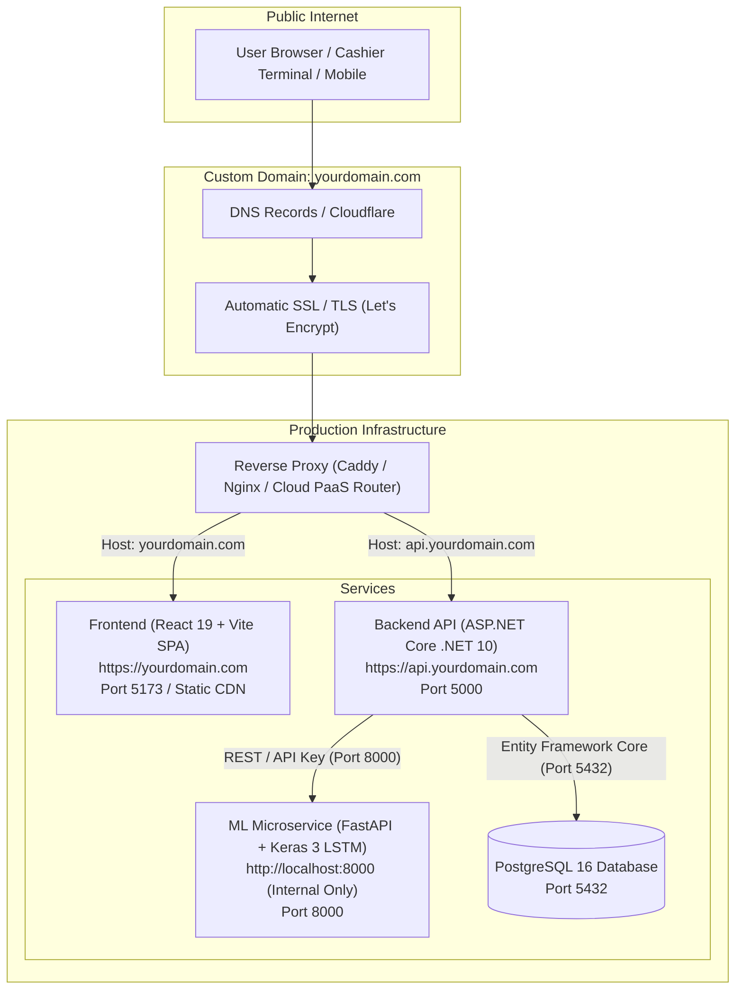
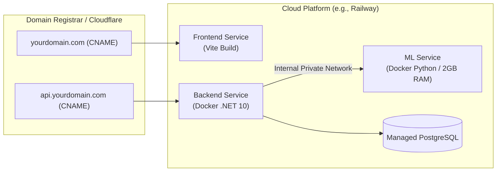

# SteelTrack Enterprise Deployment Walkthrough
**Complete Production Deployment Guide with Custom Domain Integration**

---

## 1. System Architecture & Sizing Overview

SteelTrack is composed of four interdependent tiers. When deploying to production with a custom domain, each tier must be accounted for:



### Hardware & Resource Requirements
* **Memory (RAM):**
  * **Is 4 GB really necessary?** **No, 4 GB is not strictly mandatory.** You can successfully run the entire project on a **2 GB RAM VPS** (~$3.50 to $6/month) by configuring a **2 GB to 4 GB Linux Swap file**.
  * **Component Memory Breakdown:**
    * **Ubuntu 24.04 OS & Docker Daemon:** ~350 MB
    * **PostgreSQL 16 Database:** ~100 MB – 150 MB
    * **ASP.NET Core .NET 10 API:** ~150 MB – 250 MB
    * **Frontend Container:** ~50 MB
    * **Python Keras LSTM Microservice:** ~700 MB – 1.0 GB (TensorFlow runtime & neural network model weights)
    * **Total Runtime Baseline:** **~1.4 GB to 1.8 GB active RAM**.
  * **Why 4 GB was originally recommended:** 4 GB gives "headroom" during initial container builds (`docker compose build`, compiling .NET and installing packages in parallel) without touching swap memory.
  * **Can you run on 1 GB RAM?** **No.** TensorFlow alone consumes ~700 MB upon import; a 1 GB instance will repeatedly freeze and crash with Linux `OOMKilled` (Out of Memory).
* **Storage:** 25 GB+ SSD / NVMe.
* **CPU:** 1 to 2 vCPU cores.
* **OS:** Ubuntu 24.04 LTS (or Debian 12).

---

## 2. Domain & DNS Routing Design

When using your purchased domain (referred to in this guide as `yourdomain.com`), the industry-standard design separates the public web application from the API:

| URL Endpoint | Component | Access Level | Description |
| :--- | :--- | :--- | :--- |
| `https://yourdomain.com`<br>`https://www.yourdomain.com` | **Frontend SPA** | Public | Serves the React 19 application bundle (HTML, JS, CSS, assets). |
| `https://api.yourdomain.com` | **Backend API** | Public | ASP.NET Core REST API, Swagger, JWT Auth, and SignalR Hubs. |
| `http://steeltrack-lstm:8000` | **Python ML Service** | **Private (Internal)** | **Never expose to the public domain.** The backend communicates with it via private Docker/internal networking. |
| `localhost:5432` | **PostgreSQL** | **Private (Internal)** | Isolated behind firewall; accessible only by the backend. |

---

## 3. Deployment Method A: Single Cloud VPS with Docker Compose (Recommended)

### Recommended Hosting Providers (With Philippine Payment Options & Pricing)

All providers listed below are fully capable of hosting the entire SteelTrack stack (PostgreSQL, ASP.NET Core API, Python Keras LSTM microservice, React frontend, and Caddy reverse proxy):

| Provider | Type | Recommended Plan & Specs | Estimated Cost (USD) | Estimated Cost (PHP) | Philippine Payment Methods Supported |
| :--- | :--- | :--- | :--- | :--- | :--- |
| **Hostinger** | KVM VPS | **KVM 1 / KVM 2**<br>(4 GB to 8 GB RAM, 1–2 vCPU, 50–100 GB NVMe) | **~$5.99 – $7.99 / mo** | **₱329 – ₱449 / mo** | **Native GCash (Direct QR / Dragonpay)**<br>• Maya (PayMaya)<br>• BDO / BPI / UnionBank Online<br>• 7-Eleven / Cebuana / MLhuillier |
| **Railway** | Cloud PaaS | **Hobby Plan**<br>(8 GB shared RAM pool, 8 vCPU, Monorepo multi-service) | **~$5.00 – $8.00 / mo** | **₱280 – ₱450 / mo** | **GCash Virtual Card (Visa / Mastercard)**<br>• Maya Virtual Card<br>• GoTyme / UnionBank / BPI Debit |
| **Hetzner Cloud** | Cloud VPS | **CX22 / CX32**<br>(4 GB to 8 GB RAM, 2–4 vCPU, 40–80 GB NVMe) | **~€3.79 – €7.09 / mo**<br>(~$4.10 – $7.70) | **₱230 – ₱435 / mo**<br>*(Best Value per GB)* | **GCash Virtual Card (Mastercard)**<br>• PayPal (linked to GCash / Maya)<br>• Maya Virtual Card |
| **Vultr** | Cloud VPS | **Cloud Compute**<br>(2 GB to 4 GB RAM, 1–2 vCPU, 55–80 GB SSD) | **~$10.00 – $20.00 / mo** | **₱570 – ₱1,140 / mo** | **PayPal (linked to GCash / Maya)**<br>• Alipay+ (GCash integrated)<br>• GCash Virtual Card |
| **DigitalOcean** | Cloud VPS | **Basic Droplet**<br>(2 GB to 4 GB RAM, 1–2 vCPU, 50–80 GB SSD) | **~$12.00 – $24.00 / mo** | **₱680 – ₱1,360 / mo** | **PayPal (linked to GCash / Maya)**<br>• GCash Virtual Card<br>• Maya Virtual Card |
| **Namecheap** | KVM VPS | **Pulsar / Quasar VPS**<br>(2 GB to 6 GB RAM, 2–4 vCPU, 40–120 GB SSD) | **~$6.88 – $13.88 / mo** | **₱390 – ₱780 / mo** | **GCash Virtual Card (Visa / Mastercard)**<br>• PayPal (linked to GCash)<br>• Maya Virtual Card |

---

### How to Pay Using Philippine Payment Methods

#### Method 1: Direct GCash / Maya QR (No Card Required)
* **Where it works:** **Hostinger KVM VPS**
* **Instructions:**
  1. Select your VPS plan and choose **Ubuntu 24.04 64-bit**.
  2. In the checkout screen under **Choose Payment Method**, select **GCash** or **Dragonpay**.
  3. Scan the generated QR code using your GCash or Maya app on your smartphone, or enter your registered mobile number to authorize the instant payment in Philippine Pesos (PHP).

#### Method 2: GCash Virtual Card (Visa / Mastercard) — Works on ANY International Cloud Host
* **Where it works:** **Railway, DigitalOcean, Hetzner, Vultr, Namecheap, and Render**
* **Instructions:**
  1. Open the **GCash App** on your phone.
  2. Tap **Profile** (bottom navigation bar) $\to$ **My Linked Accounts** $\to$ **GCash Card** (or **Virtual Pay**).
  3. View your 16-digit card number, expiration date (MM/YY), and 3-digit CVV.
  4. Enter these card details on Railway, DigitalOcean, or Namecheap just like a standard credit card.
  5. The subscription will automatically deduct in PHP from your GCash wallet balance at the official standard exchange rate.

#### Method 3: PayPal Linked to GCash / Maya
* **Where it works:** **DigitalOcean, Vultr, Namecheap, and Hetzner**
* **Instructions:**
  1. Link your GCash Virtual Card or Maya Virtual Card inside your **PayPal** account.
  2. At checkout on DigitalOcean or Vultr, choose **PayPal**.
  3. Authorize recurring billing, and PayPal will deduct payments straight from your GCash wallet balance without needing a traditional credit card.

---

> [!WARNING]
> **If Using Namecheap:**
> * **DO NOT buy "Shared Hosting" (Stellar / Stellar Plus):** Shared hosting only supports basic PHP/WordPress sites. It does NOT have root/sudo access and cannot run Docker, .NET 10, or Python TensorFlow.
> * **DO choose "VPS Hosting" (Pulsar or Quasar plan):** Namecheap VPS is an unmanaged Linux server with full root access, dedicated IP, and complete Docker Compose compatibility. Choose **Ubuntu 22.04 or 24.04 LTS** with **User-Responsible / Self-Managed** management.
> * **GCash on Namecheap:** Namecheap accepts your **GCash Virtual Card** or **PayPal** (linked to GCash) directly at checkout.

### Step 1: Provision the Server & Configure Memory
1. Create a Linux VPS instance running **Ubuntu 24.04 LTS**:
   * **Budget Tier (2 GB RAM, ~$4–$6/mo):** Hetzner CX22, DigitalOcean Basic 2GB, or Linode 2GB. *(Requires 4 GB Swap file below)*.
   * **Standard Tier (4 GB RAM, ~$8–$12/mo):** Hetzner CX32, DigitalOcean 4GB, or Linode 4GB. *(Runs comfortably with zero configuration)*.
2. Note your server's public IPv4 address (e.g., `203.0.113.50`).

> [!TIP]
> **If choosing a 2 GB RAM server**, run these 4 commands immediately after logging in to create a 4 GB NVMe swap file. This guarantees TensorFlow and Docker builds will never run out of memory:
> ```bash
> fallocate -l 4G /swapfile && chmod 600 /swapfile
> mkswap /swapfile && swapon /swapfile
> echo '/swapfile none swap sw 0 0' | tee -a /etc/fstab
> sysctl vm.swappiness=10
> ```

### Step 2: Configure Domain DNS Records
Log in to your domain registrar (Namecheap, GoDaddy, Cloudflare, Hostinger, etc.) and open **DNS Management**. Add the following records pointing to your VPS IP:

| Type | Host / Name | Value / Destination | TTL |
| :--- | :--- | :--- | :--- |
| **A** | `@` | `203.0.113.50` *(your VPS IP)* | Automatic / 300 |
| **A** | `www` | `203.0.113.50` *(your VPS IP)* | Automatic / 300 |
| **A** | `api` | `203.0.113.50` *(your VPS IP)* | Automatic / 300 |

> [!NOTE]
> DNS propagation typically takes 5 to 15 minutes. You can check it via `nslookup api.yourdomain.com` in your local terminal.

---

### Step 3: Install Docker & Docker Compose on the Server
SSH into your server:
```bash
ssh root@203.0.113.50
```

Run the following commands to install Docker Engine:
```bash
# Update package lists
apt update && apt upgrade -y

# Install prerequisites
apt install -y curl git ufw ca-certificates gnupg

# Install Docker
install -m 0755 -d /etc/apt/keyrings
curl -fsSL https://download.docker.com/linux/ubuntu/gpg | gpg --dearmor -o /etc/apt/keyrings/docker.gpg
chmod a+r /etc/apt/keyrings/docker.gpg

echo \
  "deb [arch=$(dpkg --print-architecture) signed-by=/etc/apt/keyrings/docker.gpg] https://download.docker.com/linux/ubuntu \
  $(. /etc/os-release && echo "$VERSION_CODENAME") stable" | \
  tee /etc/apt/sources.list.d/docker.list > /dev/null

apt update
apt install -y docker-ce docker-ce-cli containerd.io docker-buildx-plugin docker-compose-plugin

# Enable and start Docker
systemctl enable --now docker
```

---

### Step 4: Clone the SteelTrack Repository
```bash
mkdir -p /var/www
cd /var/www
git clone https://github.com/<your-username>/SteelTrack.git
cd SteelTrack
```

---

### Step 5: Configure Production Environment Variables
Create a production `.env` file in the project root:
```bash
nano .env
```

Paste and adjust the following values:
```ini
# PostgreSQL Credentials
POSTGRES_DB=SteelTrackDb
POSTGRES_USER=steeltrack_admin
POSTGRES_PASSWORD=YourStrongDatabasePassword2026!
POSTGRES_PORT=5432

# Machine Learning Service Configuration
LSTM_API_KEY=st_live_lstm_dAnBjPTeD6YZCoQdm5UX5RpZVDBqRSRLrctKzG8z-bQ
LSTM_LOOKBACK_MONTHS=24
LSTM_HORIZON_MONTHS=3
LSTM_MIN_HISTORY_MONTHS=2
LOG_LEVEL=INFO

# ASP.NET Core Backend
ASPNETCORE_ENVIRONMENT=Production
JWT_SECRET=SteelTrack_Super_Secure_Production_JWT_Secret_Key_2026_XYZ987654321!

# Frontend Public API URL (Points to your custom API subdomain)
VITE_API_URL=https://api.yourdomain.com
```

Save and exit (`Ctrl+O`, `Enter`, `Ctrl+X`).

---

### Step 6: Set Up Reverse Proxy with Automatic HTTPS (Caddy)

**Caddy** is the modern standard for containerized web hosting because it **automatically obtains, configures, and renews free SSL/TLS certificates from Let's Encrypt** with zero manual certbot commands.

1. Create a `Caddyfile` in the project root:
```bash
nano Caddyfile
```

2. Paste this configuration (replace `yourdomain.com` with your real domain):
```caddy
# Frontend: Main Web App
yourdomain.com, www.yourdomain.com {
    reverse_proxy vite-preview:5173
}

# Backend: ASP.NET Core API & SignalR WebSockets
api.yourdomain.com {
    reverse_proxy steeltrack-api:5000 {
        # Enable WebSocket buffering for SignalR live inventory updates
        header_up Host {host}
        header_up X-Real-IP {remote}
        header_up X-Forwarded-For {remote}
        header_up X-Forwarded-Proto {scheme}
    }
}
```

3. Add Caddy to your [docker-compose.yml](file:///d:/It_Project/Capstone/SteelTrack/docker-compose.yml) services:
```yaml
  caddy:
    image: caddy:2-alpine
    container_name: steeltrack-proxy
    restart: unless-stopped
    ports:
      - "80:80"
      - "443:443"
    volumes:
      - ./Caddyfile:/etc/caddy/Caddyfile:ro
      - caddy_data:/data
      - caddy_config:/config
    depends_on:
      - vite-preview
      - steeltrack-api
    networks:
      - steeltrack-net
```
*(Also add `caddy_data:` and `caddy_config:` under `volumes:` at the bottom of `docker-compose.yml`).*

---

### Step 7: Configure Firewall & Launch Services
Allow HTTP, HTTPS, and SSH through the Ubuntu firewall:
```bash
ufw allow 22/tcp
ufw allow 80/tcp
ufw allow 443/tcp
ufw enable -y
```

Build and launch the full stack in detached mode:
```bash
docker compose up -d --build
```

Check running container status:
```bash
docker compose ps
```
You should see 5 healthy running containers:
* `steeltrack-postgres`
* `steeltrack-lstm`
* `steeltrack-api`
* `steeltrack-frontend`
* `steeltrack-proxy`

---

## 4. Deployment Method B: Managed Cloud PaaS (Railway / Render)

If you prefer not to manage a Linux server directly:



### 1. PostgreSQL Service
* In your PaaS dashboard, create a new **Managed PostgreSQL** instance.
* Copy the connection string into your project environment variables.

### 2. Python ML Service (`steeltrack-lstm`)
* Connect your Git repository, set the build context to root, and select `Dockerfile.lstm`.
* **Important:** In service settings, allocate **1.5 GB – 2.0 GB RAM**.
* Set environment variable: `LSTM_API_KEY=your-secure-key`.
* Copy the generated internal DNS hostname (e.g. `steeltrack-lstm.railway.internal`).

### 3. Backend API Service (`steeltrack-api`)
* Select the `backend/` directory or root `Dockerfile`.
* Set environment variables:
  * `ASPNETCORE_ENVIRONMENT=Production`
  * `Lstm__BaseUrl=http://steeltrack-lstm.railway.internal:8000`
  * `Lstm__ApiKey=your-secure-key`
  * `ConnectionStrings__DefaultConnection=<Postgres Connection String>`
  * `Jwt__Secret=<Your Strong JWT Secret>`
* In **Settings -> Custom Domains**, add: `api.yourdomain.com`.
* Follow the prompt to add the provided CNAME record in your domain registrar.

### 4. Frontend Service (`steeltrack-frontend`)
* Connect repository, root directory: `frontend`.
* Build command: `npm run build`, Publish directory: `dist`.
* Set environment variable:
  * `VITE_API_URL=https://api.yourdomain.com`
* In **Settings -> Custom Domains**, add: `yourdomain.com` and `www.yourdomain.com`.
* Add the designated CNAME / ALIAS records in your domain registrar.

---

## 5. Domain Registrar DNS Configuration Cheat Sheet

Replace `yourdomain.com` and IP addresses with your actual values:

### When Using a VPS (A Records)
| Type | Name / Host | Value | Purpose |
| :--- | :--- | :--- | :--- |
| **A** | `@` | `203.0.113.50` | Directs root domain to VPS |
| **A** | `www` | `203.0.113.50` | Directs `www` subdomain to VPS |
| **A** | `api` | `203.0.113.50` | Directs `api` subdomain to C# backend |

### When Using PaaS (Railway / Render / Vercel) (CNAME Records)
| Type | Name / Host | Value | Purpose |
| :--- | :--- | :--- | :--- |
| **CNAME** / **ALIAS** | `@` | `steeltrack-frontend.up.railway.app` | Points root domain to frontend |
| **CNAME** | `www` | `steeltrack-frontend.up.railway.app` | Points `www` to frontend |
| **CNAME** | `api` | `steeltrack-api.up.railway.app` | Points `api` to C# backend |

---

## 6. Post-Deployment Verification & Testing

Once DNS records have propagated and containers are running, execute this validation checklist:

1. **Verify SSL/TLS Encryption:**
   * Open `https://yourdomain.com` in your browser. Ensure the padlock icon appears with no SSL certificate warnings.
   * Open `https://api.yourdomain.com/swagger` or hit a health endpoint to verify the backend API is live over HTTPS.
2. **Verify CORS Connection:**
   * Open developer tools (`F12`) on `https://yourdomain.com`.
   * Log into SteelTrack using default system credentials.
   * Check the Network tab to confirm calls to `https://api.yourdomain.com/api/auth/login` succeed with `200 OK` (no CORS origin block).
3. **Verify Python LSTM Neural Forecasting:**
   * Navigate to the **Owner Forecast / Analytics** view in the UI.
   * Select a branch and product.
   * Verify that predicted units for the 3 forward months appear and that telemetry reports `Model: v1.0.0-keras-lstm`.
4. **Verify Live SignalR Sync:**
   * Open two browser windows (one Cashier POS and one Inventory Table).
   * Process a sale or stock adjustment and confirm real-time updates propagate over the secure WebSocket connection (`wss://api.yourdomain.com/...`).

---

## 7. Database Maintenance & Backup

To ensure business continuity on production:

1. **Automated Database Backups (Cron):**
   Create a daily backup script on your server:
   ```bash
   cat << 'EOF' > /var/www/backup_db.sh
   #!/bin/bash
   BACKUP_DIR="/var/backups/steeltrack"
   mkdir -p $BACKUP_DIR
   DATE=$(date +\%Y\%m\%d_\%H\%M\%S)
   docker exec steeltrack-postgres pg_dump -U steeltrack_admin SteelTrackDb | gzip > "$BACKUP_DIR/db_$DATE.sql.gz"
   find $BACKUP_DIR -type f -mtime +14 -delete
   EOF
   chmod +x /var/www/backup_db.sh
   ```
2. Schedule it daily via `crontab -e`:
   ```cron
   0 2 * * * /var/www/backup_db.sh
   ```
